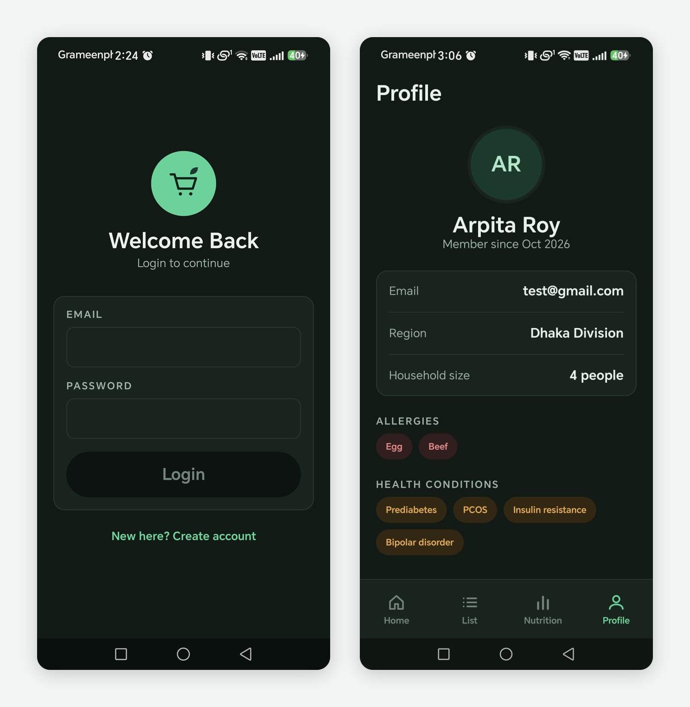
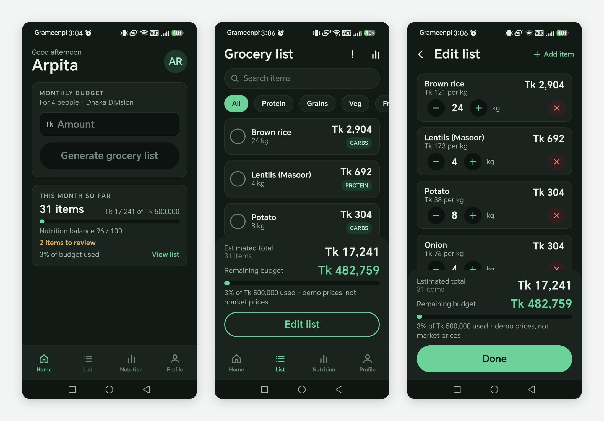
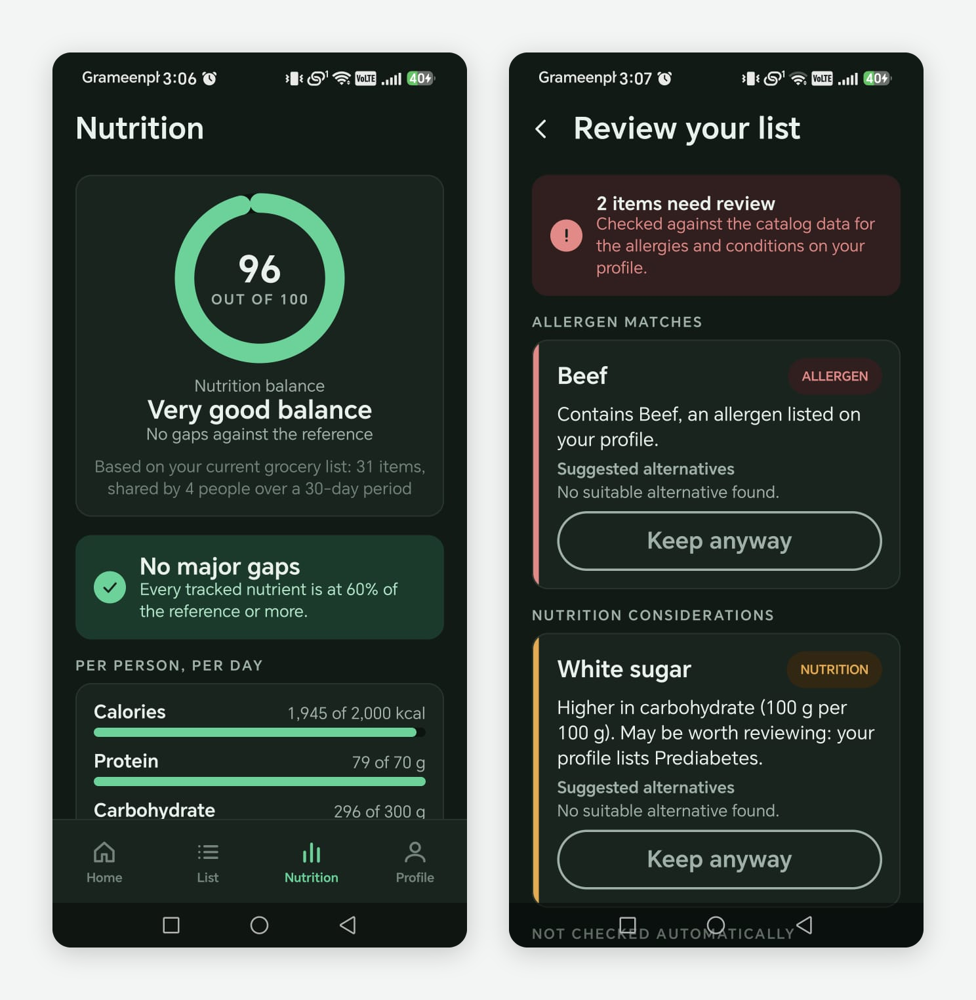

# 🥗 NutriCart

> **A smart, offline-first grocery planning and nutrition companion built with Kotlin and Jetpack Compose.**

NutriCart helps users build personalized grocery lists based on their **household size, budget, region, planning period, allergies, and health conditions**, then edit those lists and analyze their nutritional balance.

Every core flow runs **locally on the device**: accounts, profiles, list generation, editing, nutrition analysis and the allergy and health-condition review need no backend and no network. The one exception is **optional AI insights** on the grocery list, sent through Firebase AI Logic (Gemini) only when the user taps the button.

---

## ✨ Highlights

* 🛒 **Personalized grocery generation**
* 💰 **Budget-aware shopping lists**
* 📅 **Planning periods of 7, 14, 21 or 30 days**
* 📦 **Realistic pack-based quantities** (whole packs, with smaller pack sizes)
* 👨‍👩‍👧‍👦 **Household-size personalization**
* 🌍 **Region-aware pricing** across the 8 divisions of Bangladesh
* ✏️ **Fully editable grocery lists**
* 📊 **Nutrition analysis and scoring**
* ⚠️ **Allergy conflict detection**
* 🩺 **Conservative health-condition analysis**
* 🤖 **Optional AI insights and picks** (Gemini via Firebase AI Logic, validated and advisory only)
* 🔄 **Real-time list updates**
* 🔐 **Local account isolation**
* 📱 **Offline-first architecture**
* 🧪 **Comprehensive automated testing**

---

## 📱 What NutriCart Does

NutriCart follows a simple workflow:

```text
Create Account
      ↓
Complete Profile
      ↓
Set Region, Household, Allergies & Health Conditions
      ↓
Set Grocery Budget & Planning Period
      ↓
Generate Personalized Grocery List
      ↓
Edit Quantities / Add / Remove / Mark Items
      ↓
Analyze Nutrition
      ↓
Review Allergy & Health-Condition Conflicts
      ↓
(Optional) Ask for AI Insights
```

The application keeps grocery data, profile information, authentication data, and analysis state locally on the device.

---

## 🎯 Core Features

### 🛒 Personalized Grocery Generation

NutriCart generates a deterministic grocery basket using:

* Household size
* Grocery budget
* Planning period (7, 14, 21 or 30 days)
* Selected region
* Available catalog items
* Regional prices
* Profile allergies (listed ones, plus typed ones with a documented mapping)
* Supported health-condition rules

The generator prioritizes essential food coverage before optional variety and never intentionally generates a basket above the selected budget.

The basket template is a monthly amount per person. It is scaled to the planning period as a physical amount (grams, millilitres or pieces) and only then rounded up to **whole purchasable packs**, so a list never asks for "0.37 kg of lentils". Most products come in a smaller pack (for example 250 g or 500 ml) as well as the full kilo or litre.

The catalog holds **40 products in 7 food categories, available as 78 packs**, priced for **8 regions** (the divisions of Bangladesh). Prices and nutrition values are demo data.

---

### ✏️ Grocery List Editing

Generated lists remain completely editable.

Users can:

* Increase or decrease quantities
* Remove items
* Undo removals
* Search the grocery catalog
* Add additional items
* Mark items as bought
* Add duplicate items without creating duplicate rows
* Continue editing even when the list exceeds the budget

Changes are persisted locally.

---

### 📊 Nutrition Analysis

NutriCart analyzes the current grocery list using the actual quantities in the list.

The nutrition engine calculates available values for:

* Calories
* Protein
* Carbohydrates
* Fat
* Iron

Nutrition analysis is based on the available catalog data and household size.

The app provides:

* Overall nutrition score
* Nutrition balance visualization
* Macronutrient information
* Food-group variety
* Largest nutritional gap
* Highlights and observations

> **Important:** NutriCart's nutrition score is a product heuristic for general informational use. It is not a clinical or medical assessment.

---

### ⚠️ Allergy & Health-Condition Intelligence

NutriCart provides conservative rule-based conflict detection.

#### Allergy handling

The system uses explicit catalog allergen metadata rather than guessing from item names.

Supported predefined allergy groups include:

* Milk / Dairy
* Egg
* Fish
* Shellfish
* Chicken / Poultry
* Beef
* Soy
* Peanut
* Tree Nuts
* Wheat / Gluten
* Sesame

Custom allergy entries can also be stored, while automated matching is only performed where documented mappings exist.

#### Health-condition handling

The current rule engine supports condition-specific analysis only where the available nutrition/catalog data provides a reasonable basis.

Examples include:

* Diabetes
* Prediabetes
* Celiac Disease
* Anemia

Other supported profile conditions may be stored but can intentionally show that automated condition-specific analysis is unavailable when sufficient data/rules are not present.

This conservative approach avoids inventing medical recommendations.

> NutriCart is **not a medical diagnosis or treatment application**.

---

### 🤖 Optional AI Insights & Picks

On the grocery list screen, the user can ask for **AI insights**: a short advisory summary of the list, plus "AI picks from your list" with prioritized items and trade-offs. It is powered by Gemini through **Firebase AI Logic**, protected by **Firebase App Check** (debug provider in debug builds, Play Integrity in release builds).

The AI layer is deliberately kept on a short leash:

* A request is sent **only when the user taps the button**; nothing touches Firebase at app start.
* The model receives a **sanitized context**: no name, email, account ids, region or unit prices.
* Every answer is **validated against a JSON schema** before it is shown; a malformed answer becomes a friendly error with *Try again*.
* A pick is shown only if it names an item that was actually sent, and never if the allergy/health review flags that item.
* The AI **never adds, removes, reorders or re-quantifies** list items, and is never the source of truth for prices, allergens, nutrition figures or medical facts.
* Answers live in UI state only: they are never stored and are dropped when the list or profile changes.
* No API key is shipped in the app. Without `google-services.json` the app still builds and runs, and the feature reports that it is not configured.

---

## 🔐 Privacy & Offline-First Design

All core features work without:

* A remote backend
* Cloud authentication
* Internet access

Authentication is handled locally. Passwords are not stored as plaintext: NutriCart stores only salted **PBKDF2** hashes.

User data is isolated by account at the repository/database layer: repositories read the account from the session and never accept an account id from the caller.

The only network use is the optional, user-triggered AI insights described above.

---

## 🏗️ Architecture

NutriCart follows a layered architecture designed to keep UI, business logic, and persistence separate.

```text
┌───────────────────────────────┐
│          Jetpack Compose      │
│              UI               │
└───────────────┬───────────────┘
                │
                ▼
┌───────────────────────────────┐
│        ViewModels             │
│   UI State & User Actions     │
└───────────────┬───────────────┘
                │
                ▼
┌───────────────────────────────┐
│       Domain Layer             │
│                               │
│ Grocery Generator             │
│ Nutrition Calculator          │
│ Nutrition Scorer              │
│ Nutrition Insights            │
│ Profile Conflict Rules        │
└───────────────┬───────────────┘
                │
                ▼
┌───────────────────────────────┐
│       Repository Layer        │
└───────────────┬───────────────┘
                │
                ▼
┌───────────────────────────────┐
│       Local Persistence       │
│                               │
│ Room Database                 │
│ DataStore                     │
└───────────────────────────────┘
```

Key choices:

* **MVVM**: each screen is a stateful wrapper plus a stateless, previewable composable; each ViewModel exposes a single `StateFlow` of UI state.
* **Manual dependency injection** through an `AppContainer` (no Hilt), with one ViewModel factory.
* **Navigation Compose** with a bottom-navigation shell around the four tab roots.
* **Pure Kotlin domain layer**: the grocery generator, nutrition engine (calculator → scorer → insights) and conflict analyzer contain no Android, database or UI code, so they are deterministic and easy to unit-test.
* **Nothing derived is stored**: nutrition and the profile review are recomputed from the current list and profile, so edits show immediately.
* **Room with explicit migrations** (schema version 5, every step tested; no destructive fallback).
* **Token-based design system**: colours, typography, spacing, shapes and motion come from theme tokens, and screens are built from a shared component library. Charts such as the nutrition progress ring are custom Compose drawing, with no chart library.
* **Architecture rules enforced by tests**: tests fail if code outside the allowed packages imports the AI layer, and if user-facing text makes "safe/unsafe" or medical claims.

---

## 🧠 Rule-Based Intelligence

Grocery generation, nutrition scoring and the allergy/health review use **deterministic, explainable rules** that run on the device, not an AI model. The optional AI insights sit *above* these rules and cannot change their results.

For example:

```text
User Profile
     │
     ├── Allergies
     │       ↓
     │   Catalog Allergen Metadata
     │
     └── Health Conditions
             ↓
       Supported Rules
             ↓
       Conflict Analysis
             ↓
       User Review
```

The same documented conflict rules are used during grocery generation and later profile review to keep the two experiences consistent.

When reliable data is unavailable, NutriCart avoids making a condition-specific claim.

---

## 🧰 Technology Stack

| Technology          | Purpose                                     |
| ------------------- | ------------------------------------------- |
| **Kotlin**          | Primary programming language                |
| **Jetpack Compose** | Declarative UI                              |
| **Material 3**      | UI components and design system             |
| **Navigation Compose** | Screen navigation and bottom-bar shell   |
| **Room**            | Local relational database                   |
| **DataStore**       | Lightweight local preferences/session state |
| **Firebase AI Logic** | Optional Gemini-powered list insights     |
| **Firebase App Check** | Protects the AI endpoint (Play Integrity) |
| **KSP**             | Kotlin code generation                      |
| **Gradle**          | Build system                                |
| **JUnit**           | Unit testing                                |
| **Robolectric**     | JVM Android testing                         |
| **AndroidX Test**   | Android testing infrastructure              |
| **Git / GitHub**    | Version control                             |

### Project Configuration

* Kotlin: `2.2.10`
* Android Gradle Plugin: `9.3.1`
* Gradle: `9.5.0`
* Java: `11`
* Minimum SDK: `24`
* Target SDK: `37`
* Compile SDK: `37`

---

## 📂 Project Structure

```text
NutriCart/
├── app/
│   └── src/
│       ├── main/
│       │   ├── java/com/example/nutricart/
│       │   │   ├── data/
│       │   │   ├── domain/
│       │   │   ├── navigation/
│       │   │   ├── ui/
│       │   │   └── ...
│       │   └── res/
│       │
│       └── test/
│
├── project_docs/
│   ├── implementation_plan.md
│   ├── phase_1_design_system.md
│   ├── phase_2_local_storage.md
│   ├── phase_3_entry_auth.md
│   ├── phase_4_profile_shell.md
│   ├── phase_5_grocery_generation.md
│   ├── phase_6_grocery_editing.md
│   ├── phase_7_nutrition.md
│   ├── phase_8_allergy_health.md
│   ├── phase_9_ai_foundation.md
│   ├── phase_9b_firebase_ai_logic.md
│   ├── phase_10_ai_insights.md
│   ├── phase_11_ai_personalized_picks.md
│   ├── phase_12_planning_period.md
│   └── phase_13_pack_quantities.md
│
├── CLAUDE.md
├── README.md
└── ...
```

---

## 🧪 Testing

NutriCart has an automated test suite covering:

* Authentication
* Registration
* Session persistence
* Account isolation
* Profile persistence
* Database migrations
* Grocery generation
* Grocery list editing
* Quantity changes
* Duplicate item handling
* Nutrition calculations
* Nutrition scoring
* Allergy matching
* Health-condition rules
* Conflict consistency
* Planning periods and pack quantities
* AI response validation, context sanitization and pick gating
* Architecture rules (package dependencies, forbidden wording)
* Navigation
* Empty states

Tests run on the JVM with **Robolectric**, a real in-memory **Room** database and the **Compose UI test** rule, including a navigation test that drives the real nav graph and screens.

### Latest verification

```text
Tests:        494
Failures:     0
Skipped:      1   (opt-in live Gemini check, runs only when enabled)
```

The project was also manually tested on a physical Android device.

---

## 🚀 Getting Started

### Requirements

* Android Studio
* JDK 11
* Android SDK 37
* Git

### Clone the repository

```bash
git clone https://github.com/arpitaroy2024/NutriCart.git
cd NutriCart
```

### Build

On Windows:

```powershell
.\gradlew.bat assembleDebug
```

### Run tests

```powershell
.\gradlew.bat testDebugUnitTest
```

### Run lint

```powershell
.\gradlew.bat lintDebug
```

You can then open the project in Android Studio and run the `app` configuration on an Android device or emulator.

---

## 📋 Development Phases

NutriCart was developed incrementally to keep functionality, persistence, testing, and documentation aligned.

| Phase   | Focus                                     | Status     |
| ------- | ----------------------------------------- | ---------- |
| Phase 0 | Project foundation & navigation           | ✅ Complete |
| Phase 1 | Design system & reusable components       | ✅ Complete |
| Phase 2 | Local storage & authentication foundation | ✅ Complete |
| Phase 3 | Onboarding & authentication flow          | ✅ Complete |
| Phase 4 | Profile, app shell & user preferences     | ✅ Complete |
| Phase 5 | Grocery generation                        | ✅ Complete |
| Phase 6 | Grocery list editing                      | ✅ Complete |
| Phase 7 | Nutrition analysis                        | ✅ Complete |
| Phase 8 | Allergy & health-condition intelligence   | ✅ Complete |
| Phase 9 | AI reasoning foundation (Firebase AI Logic) | ✅ Complete |
| Phase 10 | Optional AI insights on the grocery list | ✅ Complete |
| Phase 11 | AI personalized picks                    | ✅ Complete |
| Phase 12 | Planning periods                         | ✅ Complete |
| Phase 13 | Realistic pack-based quantities          | ✅ Complete |

---

## 🎨 Design Philosophy

NutriCart's UI is built around:

* Clear information hierarchy
* Reusable Compose components
* Consistent spacing and typography
* Accessible interaction patterns
* Simple grocery workflows
* Visual feedback for important states
* Explainable nutrition and conflict information

The project requirements and reference designs guide functionality and flow, while the implementation is allowed to improve usability and visual design rather than reproducing reference screens blindly.

---

## ⚠️ Current Limitations

NutriCart intentionally has some limitations:

* Nutrition analysis depends on the nutrition data available in the local catalog.
* Some health conditions do not currently have enough data for automated condition-specific analysis.
* Custom health conditions do not automatically generate medical rules.
* Custom allergy matching is limited to documented mappings.
* Regional prices are local/demo catalog data rather than live market prices.
* The application does not provide clinical medical advice.
* AI insights need an internet connection and a configured Firebase project; their text is advisory only.
* No cloud synchronization is currently implemented.

These limitations are intentional where reliable data or safe domain rules are not available.

---

## 🔮 Future Possibilities

The current architecture leaves room for future improvements such as:

* Expanded nutrition datasets
* More region-specific catalog data
* Additional validated health-condition rules
* Improved visual design and accessibility
* Cloud synchronization
* Live market prices

These are **not required for the current implementation**.

---

## 📚 Documentation

Detailed implementation documentation is available in the [`project_docs`](./project_docs) directory.

The documentation covers:

* Architecture decisions
* Database design
* Authentication
* UI/UX decisions
* Grocery-generation logic
* List-editing behavior
* Nutrition calculations
* Allergy and health-condition rules
* The AI layer and its safeguards
* Planning periods and pack quantities
* Testing strategy
* Phase-by-phase implementation decisions
---
## 📱 App Screenshots

### 🔐 Authentication & Profile



### 🛒 Grocery Planning



### 📊 Nutrition & Safety


---

## 👩‍💻 Author

**Arpita Roy**

Computer Science & Engineering student and developer focused on building practical software with modern Android technologies.

---

## 📄 License

This project is currently provided for **educational and portfolio purposes**.

Add or replace this section with the project's chosen open-source license if the repository is later released under one.
